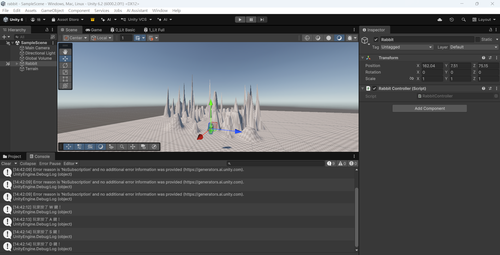
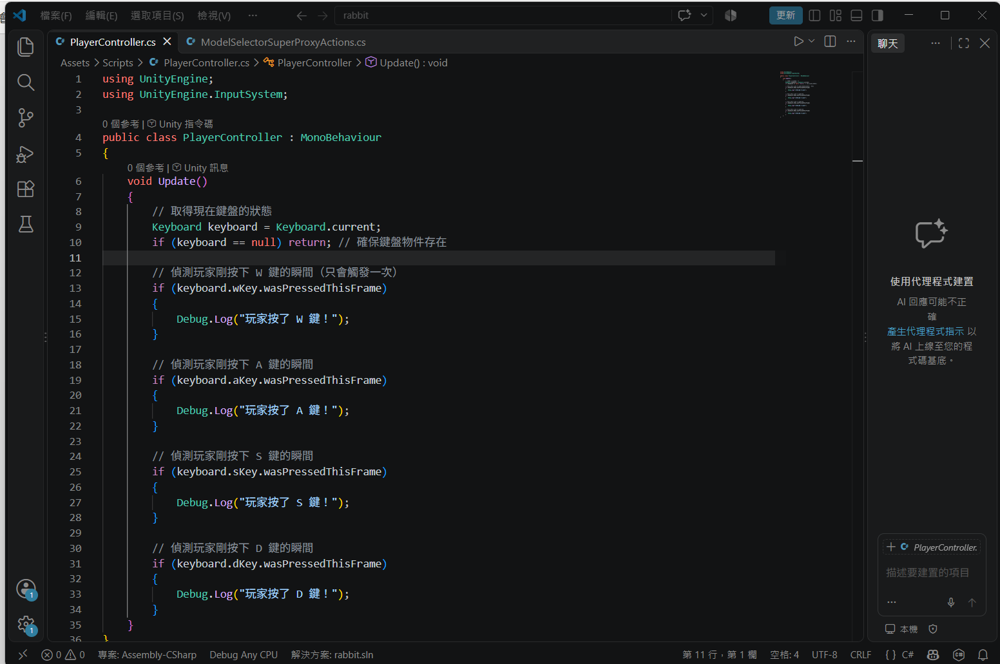
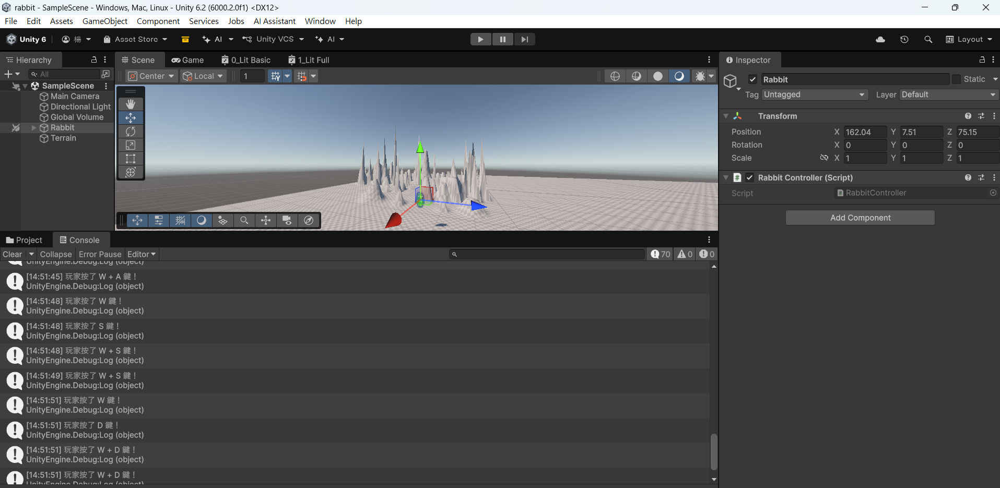
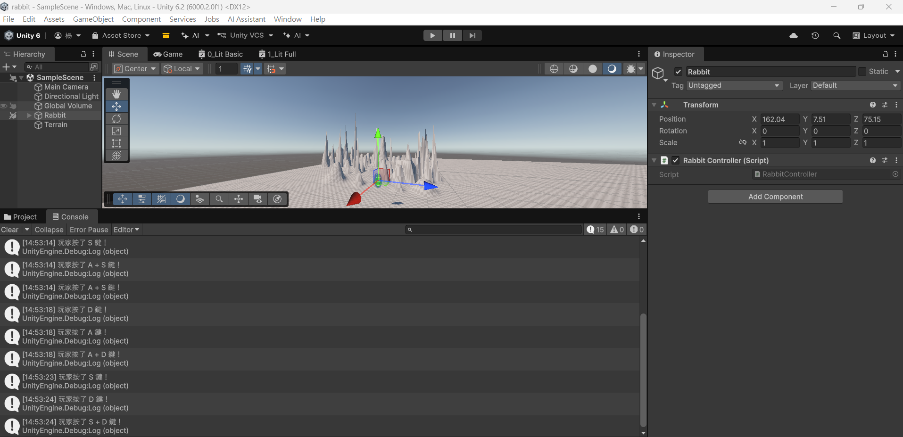
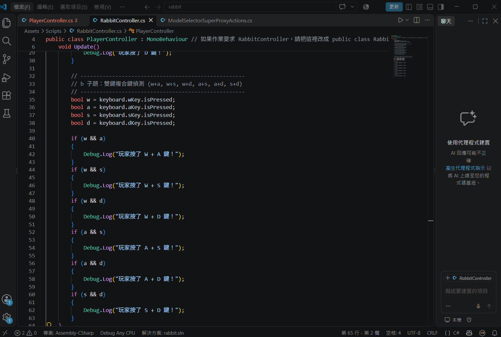

# 第2次作業題目-作業-HW2
>
>學號：113109248 (換成自己的)
><br />
>姓名：楊慧君 (換成自己的)
><br />
>作業撰寫時間：400 (mins，包含程式撰寫時間，換成自己的)
><br />
>最後撰寫文件日期：2026/10/31 (換成自己的)
>

本份文件包含以下主題：(至少需下面兩項，若是有多者可以自行新增)
- [x] 說明內容
- [x] 其他 (可以包含心得或是想跟老師反映)

## 說明內容

開始寫說明，該說明需說明想法，
並於之後再對上述想法的每一部分將程式進一步進行展現，
若需引用程式區則使用下面方法，
若為.cs檔內程式除了於敘述中需註明檔案名稱外，
還需使用語法` ```語言種類 程式碼 ``` `，其中語言種類若是要用python則使用py，java則使用java，C/C++則使用cpp，
下段程式碼為語言種類選擇csharp使用後結果：

```csharp
public void mt_getResult(){
    ...
}
```

若要於內文中標示部分網頁檔，則使用以下標籤` ```html 程式碼 ``` `，
下段程式碼則為使用後結果：

```html
<%@ Page Language="C#" AutoEventWireup="true" ...>

<!DOCTYPE html>

<html xmlns="http://www.w3.org/1999/xhtml">
<head runat="server">
<meta http-equiv="Content-Type" ...>
    <title></title>
</head>
<body>
    <form id="form1" runat="server">
        <div>
        </div>
    </form>
</body>
</html>
```
更多markdown方法可參閱[https://ithelp.ithome.com.tw/articles/10203758](https://ithelp.ithome.com.tw/articles/10203758)

請在撰寫"說明程式與內容"該塊內容，請把原該塊內上述敘述刪除，該塊上述內容只是用來指引該怎麼撰寫內容。

1. 
a.



Ans:
在 `RabbitController.cs` 的 `Update()` 方法中，宣告 `wKey`、`aKey`、`sKey`、`dKey` 四個布林變數，並透過 `Input.GetKey(KeyCode.W)` 等語法監聽按鍵狀態 。當玩家按下 W、A、S、D 任一單鍵時，主控台（Console）會即時印出對應訊息（例如：`Debug.Log("玩家按了 W 鍵！")`）。

b. 



Ans:
使用邏輯運算子 `&&` 將兩個按鍵變數進行組合（例如 `wKey && aKey`），於 `Update()` 中優先判定雙鍵同時按壓的條件（涵蓋 w+a, w+s, w+d, a+s, a+d, s+d）。當觸發雙鍵時， Console 會優先印出複合按鍵訊息（例如：`Debug.Log("玩家按了 W + A 鍵！")`）。

## 其他